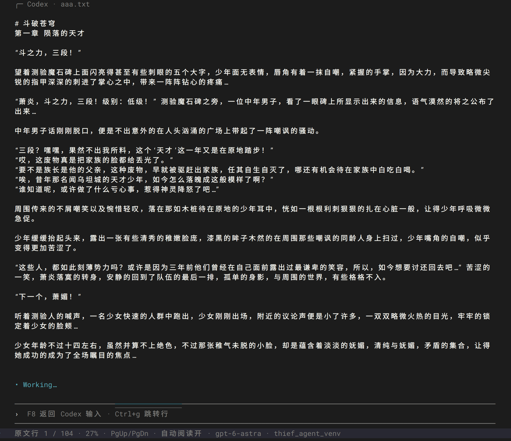

# Thief Agent

等待 Codex CLI 工作时，在同一个终端里读小说。阅读页复刻 Codex 的输入框、状态栏和留白，任务结束后自动返回真正的 Codex。



## 安装（Ubuntu / macOS）

发布产物为 `thief_agent-0.1.2-py3-none-any.whl`。需要 **Python 3.10+、tmux 3.2+ 和已安装的 Codex CLI**。正常使用前，请先确认 `codex` 能在当前终端启动并完成登录

### 1. 安装系统依赖

Ubuntu 22.04 及更新版本：

```bash
sudo apt update
sudo apt install python3 python3-venv tmux
```

macOS（已安装 [Homebrew](https://brew.sh/)）：

```bash
brew install python tmux
```

### 2. 下载并通过 pip 安装 wheel

从 [GitHub Releases](https://github.com/pishiwan/thief_codex_cli/releases) 的 Assets 下载 `.whl` 文件。在下载目录执行下列命令；使用虚拟环境可避免 Ubuntu / Homebrew Python 的 `externally-managed-environment` 限制：

```bash
python3 -m venv ~/.venvs/thief-agent
source ~/.venvs/thief-agent/bin/activate
python -m pip install ./thief_agent-0.1.2-py3-none-any.whl
thief-agent --version
```

## 快速开始

将下面的路径替换成自己的 TXT 文件：

```bash
thief-agent --book ~/books/novel.txt
```

正常启动后，像平时一样给 Codex 输入任务。任务开始后自动进入阅读页，按 **F8** 随时切回，任务完成或需要审批、输入时自动返回 Codex。按 **上 / 下** 切换行，按 **Ctrl+G** 输入原文行号跳转；阅读进度自动保存。


### 首次启动自动创建配置

安装 wheel 后，首次运行 `thief-agent` 会自动创建 `~/.config/thief-agent/config.toml`，并在终端显示文件位置。文件包含完小说路径、编码、自动阅读参数、Codex 命令和全部快捷键。

首次启动时可以直接指定小说：

```bash
thief-agent --book ~/books/novel.txt
```


## 快捷键全部可配置

编辑用户配置文件的 `[keys]` 段，重新启动后生效。完整示例见 [config.toml](https://github.com/pishiwan/thief_codex_cli/blob/main/config.toml)。按键直接生效，无需 tmux 前缀。

| 配置项 | 默认按键 | 功能 |
| --- | --- | --- |
| `toggle` | **F8** | Codex ↔ 小说，两页均有效 |
| `auto_read` | **F9** | 开关任务开始后的自动阅读，两页均有效 |
| `next_page` | **PgDn / Space** | 下一页 |
| `previous_page` | **PgUp** | 上一页 |
| `line_down` / `line_up` | **↓ / ↑** | 滚动一行 |
| `book_start` / `book_end` | **Home / End** | 书首 / 书尾 |
| `goto_line` | **Ctrl+G** | 输入原文行号并跳转 |
| `back` | **Esc / Ctrl+C** | 从小说返回 Codex，不中断任务 |


## 按原文行号快速跳转

左下角显示 `原文行 123 / 8240`，表示正文顶部所在的原文行和总行数。在阅读页按 **Ctrl+G**，输入行号后按 **Enter**，目标行会出现在正文顶部，并立即保存进度；


其他命令：

```bash
thief-agent --help
thief-agent --version
thief-agent --check-config
thief-agent --book ~/books/novel.txt --encoding gb18030
thief-agent --book ~/books/novel.txt --no-auto-reader

# -- 后的参数交给原版 Codex
thief-agent --book ~/books/novel.txt -- -C /path/to/project
thief-agent --book ~/books/novel.txt -- resume --last
```
